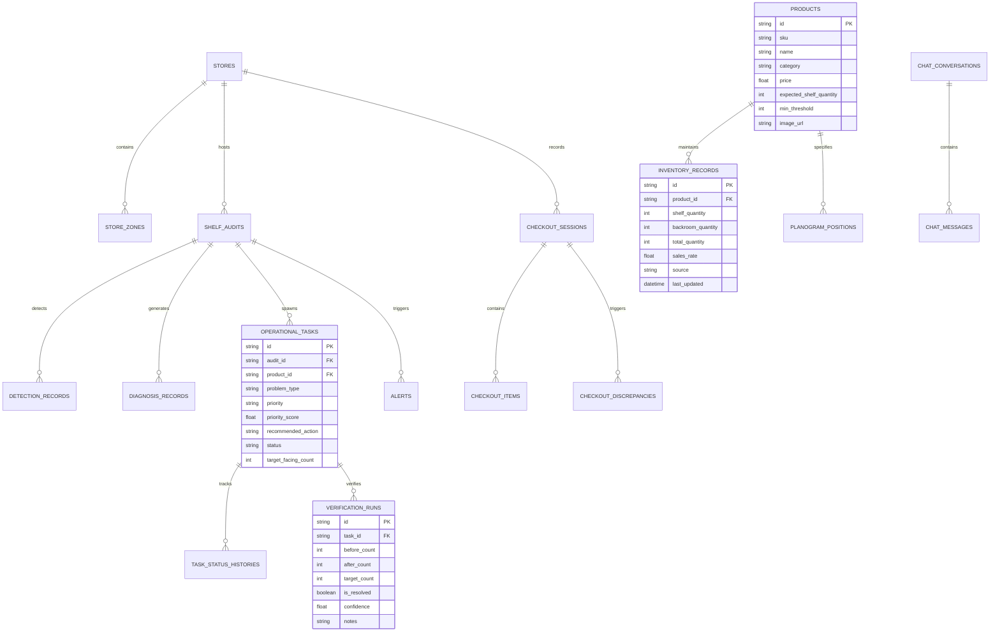

# RetailVision 360 — System Architecture

## 1. Overview & Core Philosophy

**RetailVision 360** is an enterprise-grade multimodal retail intelligence platform engineered around the flagship paradigm of **Shelf-to-Action Intelligence**:

```
[Capture Image] ➔ [Detect Objects] ➔ [Compare Planogram] ➔ [Diagnose Inventory]
      ➔ [Explainable Priority Scoring] ➔ [Dispatch Operational Task]
      ➔ [Associate Remediation] ➔ [Optical Verification] ➔ [Closed-Loop Resolution]
```

Traditional retail camera solutions stop at passive alerting or heatmaps. RetailVision 360 connects computer-vision inference directly to inventory ledgers, planogram specifications, backroom stock availability, and employee task loops to drive verified operational remediation.

---

## 2. High-Level Architecture Diagram

```mermaid
graph TB
    subgraph Frontend ["Frontend (React 19 + TypeScript + Vite + Tailwind CSS)"]
        UI[Executive Dashboard & Pages]
        GeminiChat[RetailVision AI Copilot Drawer]
        APIClient[Axios Typed API Client]
        UI --> APIClient
        GeminiChat --> APIClient
    end

    subgraph Backend ["FastAPI Application (Python 3.11)"]
        API[REST API Router /api]
        AuthSec[Security & Input Validator]
        API --> AuthSec

        subgraph Vision ["Computer Vision & Recognition Engine"]
            YOLO[Ultralytics YOLOv8n (CPU)]
            Morph[OpenCV Saturation Contour Fallback]
            Recog[HSV 3D Histograms + ORB Feature Matcher]
            PlanoMatch[Spatial Planogram Grid Matcher]
        end

        subgraph CoreServices ["Deterministic Intelligence Services"]
            DiagSvc[Inventory-Aware Diagnosis Engine]
            PrioSvc[Explainable Priority Scoring Engine]
            TaskSvc[Task Life-Cycle & State Machine]
            VerifySvc[Optical Verification Engine]
            ContextSvc[Read-Only SQLite Retail Context Retriever]
        end

        subgraph GeminiAgent ["Gemini AI Copilot"]
            GenAISDK[Google GenAI SDK (google-genai)]
            SystemPrompt[Strict Grounding & Security System Instructions]
        end

        AuthSec --> Vision
        AuthSec --> CoreServices
        ContextSvc --> GeminiAgent
        GenAISDK --> SystemPrompt
    end

    subgraph Storage ["Persistence Layer (SQLite + Local Storage)"]
        DB[(retailvision360.db)]
        Uploads[Static Storage: /uploads & /sample_data]
    end

    CoreServices --> DB
    Vision --> Uploads
    API --> DB
```

---

## 3. Database Schema & Relational Design

The system is backed by SQLite through SQLAlchemy ORM, ensuring ACID guarantees and zero-cost local embedded deployment.



---

## 4. The Five Differentiating Innovations

### Innovation 1: Expected-vs-Observed Planogram Comparison
- **Mechanism**: The `PlanogramMatcher` decomposes shelf physical boundaries into a normalized `Rows x Columns` grid based on user-configured facings.
- **Inference**: Detected bounding box centroids are spatially matched to grid slots.
- **Reporting**: Computes visible facing count vs. expected count, isolates empty slot coordinates, and identifies unexpected SKUs without falsely claiming identity without optical matching.

### Innovation 2: Small-Catalog Product Recognition with Honest Uncertainty
- **Multi-Modal Feature Matching**:
  1. **3D HSV Color Histograms**: Computes 8x8x8 bin normalized hue-saturation-value distribution compared via Bhattacharyya distance.
  2. **ORB Keypoint & Descriptor Matching**: Scale and rotation-invariant feature extraction matched via Hamming distance BFMatcher.
  3. **Composite Scoring**: Combined weighted similarity score (`score = 0.65 * hist + 0.35 * orb`).
- **Uncertainty Gate**: Scores $\ge 0.55$ are labeled as candidate matches. Scores between $0.35$ and $0.55$ are flagged as **Uncertain — Manual Verification Required**. Scores $< 0.35$ are classified as **Unidentified Packaging**.

### Innovation 3: Inventory-Aware Diagnosis Engine
A shelf gap by itself is ambiguous. The `DiagnosisEngine` cross-references vision detections with persistent backroom and distribution records:
- **Case A**: Visible occupancy $< 50\%$ AND `backroom_quantity` $> 0$ ➔ **Restock Immediately from Backroom** (Operational gap).
- **Case B**: Visible occupancy $< 50\%$ AND `backroom_quantity` $== 0$ ➔ **Potential Total Stockout — Trigger PO Reorder** (Supply chain gap).
- **Case C**: Visible occupancy normal but SKU misplaced ➔ **Planogram Alignment Audit Required**.
- **Case D**: Image low illumination or blur ➔ **Insufficient Visual Evidence — Schedule Re-audit**.

### Innovation 4: Explainable Operational Priority Engine
Rather than an uninterpretable machine-learning black box, RetailVision 360 uses a documented multi-factor formula:

$$\text{Priority Score} = 0.35 \cdot S_{\text{gap}} + 0.25 \cdot S_{\text{sales}} + 0.20 \cdot S_{\text{backroom}} + 0.10 \cdot S_{\text{age}} + 0.10 \cdot S_{\text{evidence}}$$

Where:
- $S_{\text{gap}} = 1.0 - \min(1.0, \frac{\text{observed facings}}{\text{target facings}})$
- $S_{\text{sales}} = \min(1.0, \frac{\text{sales velocity}}{10.0 \text{ units/day}})$
- $S_{\text{backroom}} = 1.0 \text{ if } \text{backroom stock} > 0 \text{ else } 0.3$
- $S_{\text{age}} = \min(1.0, \frac{\text{unresolved hours}}{24.0})$
- $S_{\text{evidence}} = \text{detection confidence} \in [0, 1]$

**Priority Bands**:
- Score $\ge 75$: **CRITICAL** (Immediate front-of-store action)
- Score $\ge 55$: **HIGH** (Restock within current shift)
- Score $\ge 35$: **MEDIUM** (Routine replenishment)
- Score $< 35$: **LOW** (Monitor on next scheduled audit)

### Innovation 5: Closed-Loop Verification
Pressing a "Complete" button does **not** close an operational task.
- To resolve a task, the employee must upload a follow-up image of the restocked shelf.
- The `VerificationService` runs CV detection on the post-remediation image.
- Evaluates:
  $$\text{Resolved} \iff \text{Observed Visible Count} \ge \text{Target Facing Count}$$
- If the threshold is satisfied, the task transitions to `RESOLVED` with audited before/after metrics.
- If the threshold is not satisfied, the task transitions to `FAILED_NEEDS_REVIEW` and generates an escalation alert.

---

## 5. Gemini AI Copilot Integration Architecture

The RetailVision AI Copilot is built using the official `google-genai` Python SDK:
1. **Zero Client-Side Exposure**: API keys reside solely in server environment variables.
2. **Context-Grounded Retrieval**: The `RetailContextService` extracts real database facts (open tasks, alert counts, store zone dwell times, audit summaries) into an executive summary passed into the model prompt.
3. **Strict System Instructions**: Guardrails prevent SQL execution, arbitrary shell calls, or hallucinated SKU quantities.
4. **Action Dispatcher**: Emits structured navigation actions (`NAVIGATE_TO_TASK`, `NAVIGATE_TO_AUDIT`, `FILTER_ALERTS`) that the frontend safely renders as deep-links.
